# ⚡ EnergyStream — Real-Time IoT Energy Utilization Analytics

[](https://www.python.org/)
[](https://kafka.apache.org/)
[](https://spark.apache.org/)
[](https://scikit-learn.org/)
[](https://streamlit.io/)
[](LICENSE)

**EnergyStream** is an end-to-end, real-time IoT energy monitoring and anomaly detection platform. It simulates 10 household smart appliances generating live voltage, current, and power readings, streams telemetry through **Apache Kafka**, processes and enriches data via **Apache Spark Structured Streaming**, detects consumption anomalies using an **unsupervised scikit-learn Isolation Forest model**, and visualizes real-time metrics and alerts on an interactive **Streamlit** dashboard.

---

## 🏗️ Architecture

```mermaid
flowchart LR
    subgraph IoT["🔌 IoT Layer"]
        A[energy_simulator.py<br/>10 Household Devices]
        B[producer.py<br/>Kafka Producer]
        A --> B
    end

    subgraph Messaging["📨 Streaming Broker"]
        C[(Apache Kafka<br/>Topic: energy-data)]
        B -->|JSON Telemetry| C
    end

    subgraph Analytics["⚡ Spark & ML Engine"]
        D[spark_pipeline.py<br/>Spark Structured Streaming]
        E[Feature Engineering<br/>Imputer + VectorAssembler]
        F[Unsupervised ML<br/>Isolation Forest Anomaly Model]
        G[Rule Classifier<br/>Power Ratio Threshold]
        C --> D
        D --> E --> F --> G
    end

    subgraph Storage["💾 Storage"]
        H[(data/energy_data.csv)]
        G -->|Processed & Scored Rows| H
    end

    subgraph Presentation["📊 Dashboard"]
        I[dashboard.py<br/>Streamlit UI & Plotly Charts]
        H --> I
    end
```



---

## 🌟 Key Features

- **Virtual IoT Telemetry Simulator**: Emulates 10 household devices (Air Conditioner, Water Heater, Refrigerator, etc.) reporting voltage, current, active power, and temperature with stochastic noise and occasional anomaly spikes.
- **High-Throughput Ingestion**: Apache Kafka broker (`localhost:9092`) buffering real-time sensor streams over topic `energy-data`.
- **Spark Structured Streaming Engine**: Scalable stream processing with watermarking, deduplication, catalog join enrichment, and feature generation.
- **Dual Anomaly Detection**:
  - **Machine Learning (Isolation Forest)**: Trains and retrains online on a sliding window buffer (`voltage`, `current`, `power`, `temperature`, `power_ratio`) to flag statistical multivariate outliers (`ANOMALY`).
  - **Heuristic Rule-Based Alerts**: Detects sudden high energy surges exceeding $1.8 \times$ device baseline wattage (`HIGH`).
- **Interactive Live Dashboard**: Built with Streamlit and Plotly:
  - Real-time KPI summary cards (Total Real-Time Power, Total Energy Consumption, Active Devices, Active Alerts).
  - Time-series power consumption trend lines.
  - Device wattage comparison bar chart color-coded by status.
  - Energy breakdown by room/location.
  - Live activity log and anomaly inspection table.
  - Sidebar filters by appliance and location.
- **Cross-Platform Windows & Linux Readiness**: Bundles Windows Hadoop binaries (`winutils.exe` & `hadoop.dll`) directly within `hadoop/bin/` so Spark runs without external configuration.

---

## 📁 Repository Structure

```text
EnergyStream/
│
├── .gitignore                  # Git exclusions for venv, checkpoints, and binaries
├── docker-compose.yml          # 1-command Apache Kafka setup via Docker
├── requirements.txt            # Python dependencies (pyspark, kafka-python, streamlit, etc.)
├── SETUP_INSTRUCTIONS.md       # Comprehensive setup guide for teammates & AI agents
│
├── config.py                   # Centralized configuration & thresholds
├── energy_simulator.py         # Virtual IoT device catalog & telemetry generator
├── producer.py                 # Publishes simulated IoT telemetry to Kafka
├── consumer.py                 # Entry point triggering Spark streaming pipeline
├── spark_pipeline.py           # Core Spark Structured Streaming & Isolation Forest pipeline
├── analytics.py                # Analytics helper functions (rules, energy calculations)
├── dashboard.py                # Interactive Streamlit dashboard
│
├── hadoop/
│   └── bin/                    # Pre-packaged winutils.exe & hadoop.dll for Windows PySpark
├── models/
│   └── .gitkeep                # Directory for dynamic Isolation Forest model checkpoints
├── data/
│   ├── energy_data.csv         # Stream output read by the dashboard
│   ├── spark_sample.csv        # Reference IoT sample dataset for batch testing
│   └── spark_sample_out.csv    # Reference output dataset
│
├── start_all.bat               # Windows: 1-click startup script for all components
├── start_kafka.bat             # Windows: Starts Kafka broker in KRaft mode
├── start_consumer.bat          # Windows: Starts Spark consumer pipeline
├── start_producer.bat          # Windows: Starts IoT producer
├── start_dashboard.bat         # Windows: Starts Streamlit dashboard
└── start_all.sh                # Linux/macOS: Shell script to launch the stack
```

---

## ⚡ Quickstart

For full instructions tailored for both developers and AI agents, see [SETUP_INSTRUCTIONS.md](SETUP_INSTRUCTIONS.md).

### 1. Clone & Set Up Environment
```bash
git clone https://github.com/suhani3000/EnergyStream_DASSS_mini.git
cd EnergyStream_DASSS_mini

python -m venv venv
# Windows:
.\venv\Scripts\activate
# Linux/macOS:
source venv/bin/activate

pip install -r requirements.txt
```

### 2. Start Kafka
- **Via Docker (Recommended)**:
  ```bash
  docker compose up -d
  ```
- **Or via Local Binary (Windows)**:
  ```cmd
  start_kafka.bat
  ```

### 3. Launch the Stack
- **Windows (1-Click)**:
  ```cmd
  start_all.bat
  ```
- **Manual (Four Terminals)**:
  1. `start_kafka.bat` (or `docker compose up -d`)
  2. `python consumer.py`
  3. `python producer.py`
  4. `streamlit run dashboard.py`

### 4. Open Dashboard
Visit **`http://localhost:8501`** in your browser to view the real-time analytics.

---

## 🧪 Offline / Batch Mode (Zero Kafka Needed)

You can run and test the complete PySpark feature engineering and scikit-learn Isolation Forest pipeline without starting Kafka:

```bash
python spark_pipeline.py --batch --input data/spark_sample.csv --output data/energy_data.csv
streamlit run dashboard.py
```

---

## 🔌 Virtual Device Catalog

| Device ID | Appliance | Location | Base Power | Normal Range |
| :--- | :--- | :--- | :--- | :--- |
| `DEV_001` | Air Conditioner | Bedroom | 1400 W | 1190 – 1610 W |
| `DEV_002` | Refrigerator | Kitchen | 250 W | 212 – 288 W |
| `DEV_003` | Television | Living Room | 120 W | 102 – 138 W |
| `DEV_004` | Washing Machine | Utility Room | 900 W | 765 – 1035 W |
| `DEV_005` | Computer | Study Room | 350 W | 297 – 403 W |
| `DEV_006` | Ceiling Fan | Bedroom | 80 W | 68 – 92 W |
| `DEV_007` | Microwave | Kitchen | 1100 W | 935 – 1265 W |
| `DEV_008` | Lights | Hall | 100 W | 85 – 115 W |
| `DEV_009` | Water Heater | Bathroom | 1800 W | 1530 – 2070 W |
| `DEV_010` | WiFi Router | Study Room | 20 W | 17 – 23 W |

---

## 📜 License

This project is licensed under the MIT License — see the [LICENSE](LICENSE) file for details.
